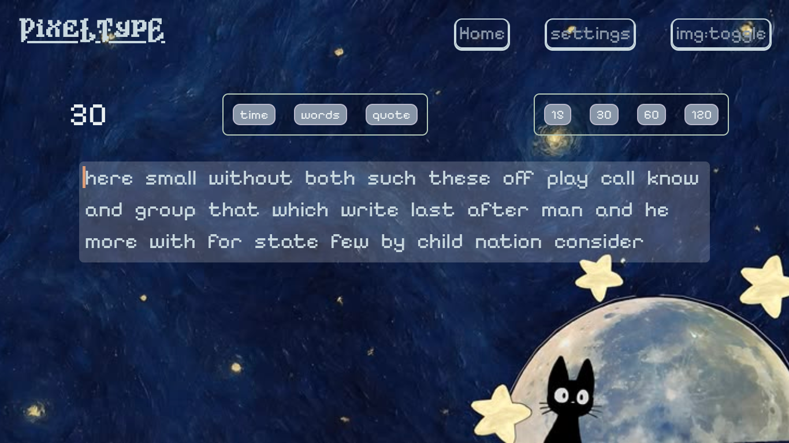

# pixelType

## Website Look



## About

Welcome to pixelType! IT is a typing test where you type in pixels : ) Yup, you doooo! You type in pixels every time, but this is a cuter version, and this website is just a cozy place on the internet to do typing tests.

**Note:** It is under construction (Yup, software engineers are the labour).

It is completely made with HTML, CSS, and JS, and it is super fast, btw. There will be music and other things in the future. For now, it is going through basic changes and improvements.

## Use Locally

This project uses npm. You can clone this repository and run it locally.

**1. Install the dependencies**

```bash
npm install
```

This will install the required dependencies, including Vite, which is used as the development server. You can then modify the code and see your changes in the browser.

**2. Start the development server**

```bash
npm run dev
```

If you're new to npm, you can learn its basics and then try running the project locally.

But if you don't want to deal with npm right now, I'd suggest trying it on GitHub Pages. It's already deployed there: [Website page](https://krish-saga.github.com/pixelType).

## Fair Use

This project is made under the MIT License. Do whatever you want with it, like WHATEVER, because it is for fun and learning. And yupppppppp!

## Contribution

Well, you can contribute to this code, which is super messy. I don't think anyone other than me can understand it right now, lol. If you don't want to spend a day figuring out each function, it is really messy. I'll add a contribution guide once it gets good enough.

## This README Ended Here

I can't yappp much. What are you waiting for? Just go type and enjoy the web!
